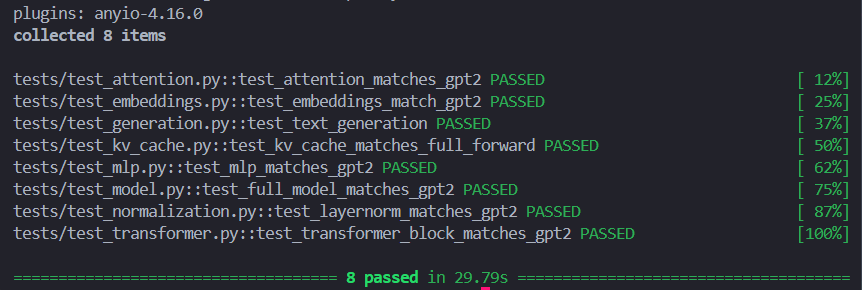
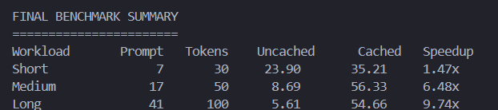
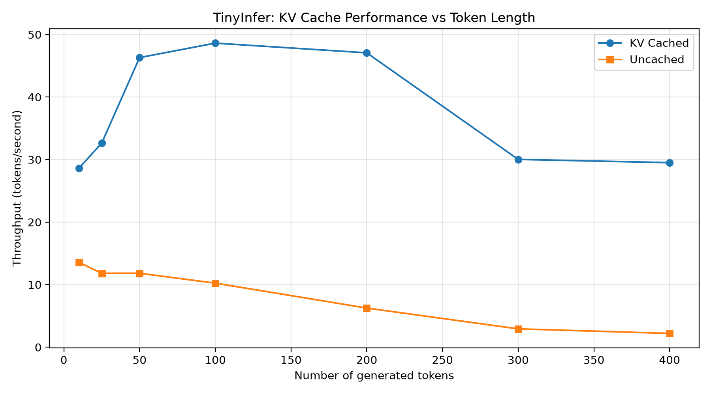
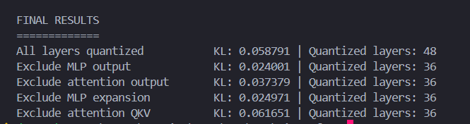
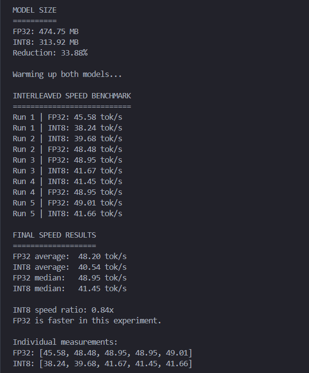
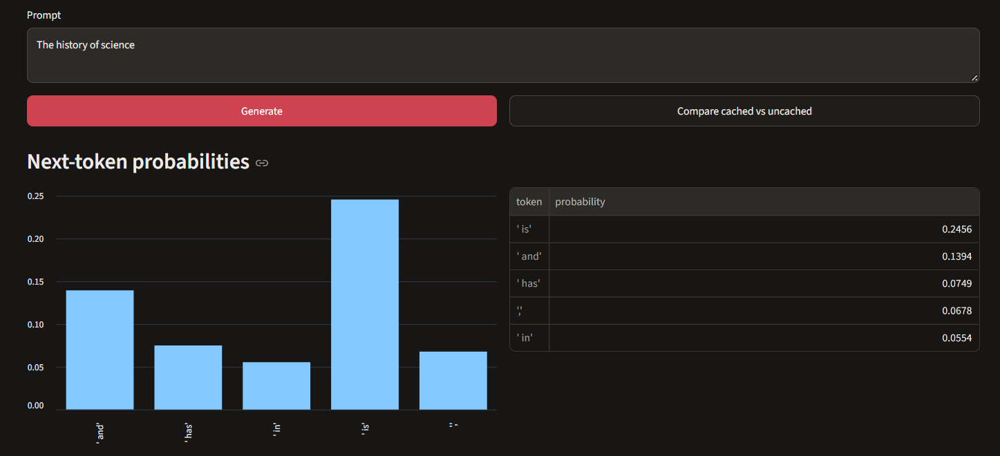
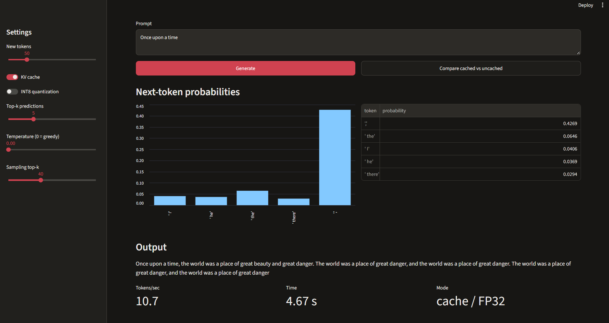
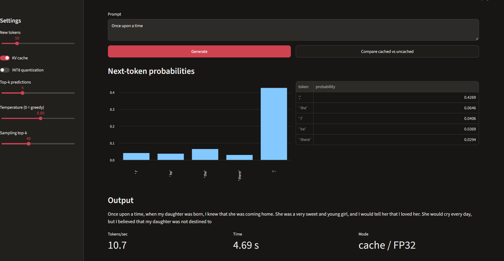
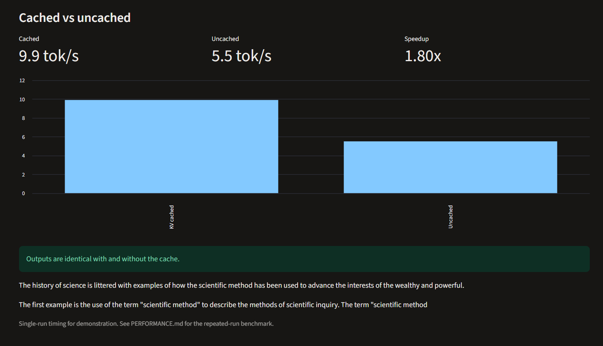

# TinyInfer: A From-Scratch GPT-2 Inference Engine with KV Caching and INT8 Quantization

## Summary

TinyInfer is a GPT-2 Small (124M parameter) inference engine written from scratch in PyTorch. The transformer components, the autoregressive generation loop and the KV cache are implemented directly instead of calling Hugging Face's `generate()`. Pretrained GPT-2 weights are loaded into the custom architecture, and every component is tested numerically against the Hugging Face reference.

On top of the engine, the project measures what inference optimizations actually do on a CPU:

- **KV caching** speeds up decoding by 2.1x at 10 new tokens and 13.4x at 400 new tokens, with identical generated tokens.
- **INT8 dynamic quantization** reduces model size by 33.9% in the tested configuration. A per-layer sweep shows the MLP layers cause most of the quantization error. On this CPU at batch size 1, INT8 ran about 16% slower than FP32.
- A **Streamlit demo** lets you toggle the cache and quantization, inspect next-token probabilities, and compare cached and uncached generation live.

Full numbers and caveats are in [`PERFORMANCE.md`](docs/performance.md).

**Environment:** Windows 11, Python 3.13.9, PyTorch 2.11.0 (CPU), Intel Core i7-13620H.

## Setup

```bash
pip install torch transformers streamlit pandas pytest
python -m pytest tests/ -v
python -m streamlit run app.py
```
---

## 1. From-Scratch Model, Verified Against Hugging Face

The architecture (embeddings, LayerNorm, multi-head attention, MLP, transformer blocks) is implemented in `tinyinfer/model.py`. Pretrained weights are loaded into it, and each component has a test that compares its output with the Hugging Face GPT-2 implementation.

```python
from tinyinfer.model import TinyInferGPT2
from tinyinfer.weights import load_gpt2_weights

model = TinyInferGPT2()
load_gpt2_weights(model)      # loads pretrained "gpt2" weights
model.eval()

logits, past_key_values = model(input_ids)   # (1, T, 50257), KV cache
```

Run the tests:

```bash
python -m pytest tests/ -v
```

Tests cover embeddings, LayerNorm, attention, the MLP, a full transformer block, the full model, text generation, and cached-vs-full-forward equivalence.

**Output:**



---

## 2. KV Cache

During generation, the model processes the prompt once (prefill), stores each layer's keys and values, and then feeds only the newest token at each step. Without the cache, every step recomputes the whole sequence.

```python
# Cached decoding loop (from benchmarks)
logits, past_key_values = model(generated_ids)            # prefill

for step in range(max_new_tokens):
    next_token = torch.argmax(logits[:, -1, :], dim=-1, keepdim=True)
    generated_ids = torch.cat([generated_ids, next_token], dim=1)

    if step < max_new_tokens - 1:
        logits, past_key_values = model(
            next_token, past_key_values=past_key_values   # one token at a time
        )
```

The cache costs 72 KiB per token for GPT-2 Small (2 x 12 layers x 768 x 4 bytes), or 72 MiB at the full 1024-token context.

Cached and uncached generation produce identical token sequences, and the benchmark script raises an error if they ever differ.

**Output (workload benchmark):**



---

## 3. Token Length Sweep

Throughput of cached and uncached decoding as the number of generated tokens grows.

| New tokens | Uncached (tok/s) | KV cached (tok/s) | Speedup |
|---:|---:|---:|---:|
| 10 | 13.56 | 28.64 | 2.11x |
| 50 | 11.82 | 46.31 | 3.92x |
| 100 | 10.24 | 48.62 | 4.75x |
| 200 | 6.25 | 47.07 | 7.53x |
| 400 | 2.20 | 29.51 | 13.41x |

Uncached throughput falls steadily as sequences grow. Cached throughput is roughly flat from 50 to 200 tokens. The cached dips at the smallest and largest lengths are not yet explained (see `PERFORMANCE.md`).

**Output (plot):**



---

## 4. INT8 Quantization and Layer Sensitivity

Linear layers are quantized with PyTorch dynamic quantization (per-channel INT8 weights). The token embedding and tied output head stay in FP32.

```python
import torch.nn as nn
from torch.ao.quantization import per_channel_dynamic_qconfig, quantize_dynamic

def quantize_selective(model, should_quantize):
    spec = {"lm_head": None}                      # keep tied head in FP32
    for name, m in model.named_modules():
        if isinstance(m, nn.Linear) and name != "lm_head" and should_quantize(name):
            spec[name] = per_channel_dynamic_qconfig
    return quantize_dynamic(model.eval(), qconfig_spec=spec, dtype=torch.qint8)

# Example: leave the MLP output projections in FP32
quantized = quantize_selective(model, lambda n: not n.endswith("mlp.proj"))
```

Switching from per-tensor to per-channel weights cut KL divergence from 0.201 to 0.059. A per-layer-type sweep then showed where the remaining error comes from:

| Configuration | KL vs FP32 | Quantized layers |
|---|---:|---:|
| All layers | 0.0588 | 48 |
| Exclude MLP output (`mlp.proj`) | 0.0240 | 36 |
| Exclude MLP expansion (`mlp.fc`) | 0.0250 | 36 |
| Exclude attention output | 0.0374 | 36 |
| Exclude attention QKV | 0.0617 | 36 |

The MLP layers dominate the error. These are single-prompt measurements, so differences of about 0.001 are noise.

**Output (sweep):**



### Size and speed (FP32 vs INT8)

| Config | Size (MiB) | Median tok/s | Speed vs FP32 |
|---|---:|---:|---:|
| FP32 | 474.75 | 48.95 | 1.00x |
| INT8 (selective) | 313.92 | 41.45 | 0.84x |

On this CPU at batch size 1, INT8 is smaller but slower than FP32, because dynamic quantization adds activation-quantization overhead on every layer call.

**Output (benchmark):**



---

## 5. Next-Token Probability Explorer

Shows the top-k predictions and their probabilities for any prompt.

```python
@torch.inference_mode()
def top_k_table(model, tok, ids, k):
    logits, _ = model(ids)
    probs = torch.softmax(logits[0, -1], dim=-1)
    p, i = probs.topk(k)
    return pd.DataFrame(
        {"token": [repr(tok.decode(int(x))) for x in i], "probability": p.tolist()}
    ).set_index("token")
```

**Output:**



---

## 6. Sampling

Greedy decoding with GPT-2 Small often falls into repeating loops, in both FP32 and INT8. The demo adds temperature and top-k sampling for the Generate button. The cached-vs-uncached comparison stays greedy, because outputs only match exactly when decoding is deterministic.

```python
def pick_next(logits, temperature, sample_k):
    last = logits[:, -1, :]
    if temperature == 0.0:                         # greedy
        return torch.argmax(last, dim=-1, keepdim=True)
    vals, idx = torch.topk(last / temperature, sample_k, dim=-1)
    choice = torch.multinomial(torch.softmax(vals, dim=-1), 1)
    return idx.gather(-1, choice)
```

**Output (greedy loop vs sampled text):**





---

## 7. Streamlit Demo

```bash
python -m streamlit run app.py
```

The app has a prompt box, KV cache and INT8 toggles, temperature and top-k controls, the next-token probability chart, and a **Compare cached vs uncached** button that runs both modes, reports the speedup, and checks the outputs are identical.

Demo timings are single runs inside Streamlit and are slower than the terminal benchmarks (about 14 vs 48 tok/s for FP32). Use `PERFORMANCE.md` for benchmarked numbers.


**Output (cached vs uncached comparison):**



---


## Limitations

- All measurements are from one CPU, one software environment and one model.
- Quantization quality results are from a single prompt. Multi-prompt KL and WikiText-2 perplexity are still to be done.
- Cached throughput at 10-25 and 300-400 new tokens is lower than at 50-200 for reasons not yet identified.
